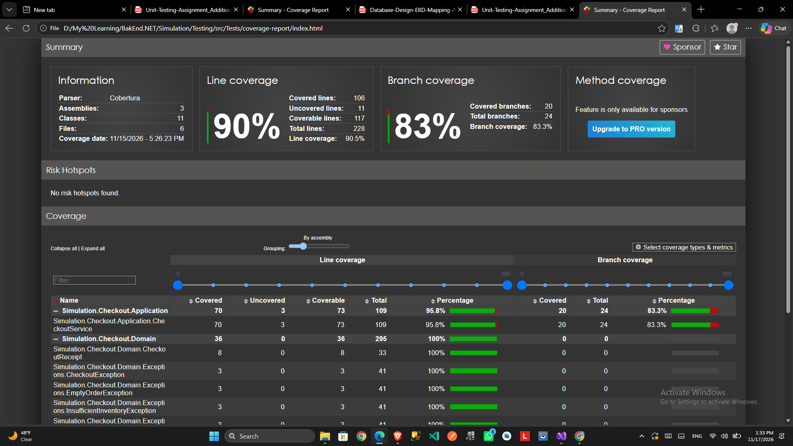

# Total tests, passing, failing?

-->All implemented unit tests passed successfully.

# Line coverage %:

--> 90.5%

# Moq, AutoFixture, and Bogus usage:

1- Moq: Used to mock repository interfaces to isolate the business logic during unit testing.
2-AutoFixture: Used to automatically generate test object instances and reduce setup of code.
3-Bogus: Used to generate r fake data such as names, emails for test scenarios.

# Examples B and C fairness question:

-->
No, it creates a pricing anomaly where a customer spending 999.99 ends up paying more overall than someone spending 1,000 because they miss out on a threshold-based discount.

# Any bug found:

-->None.
